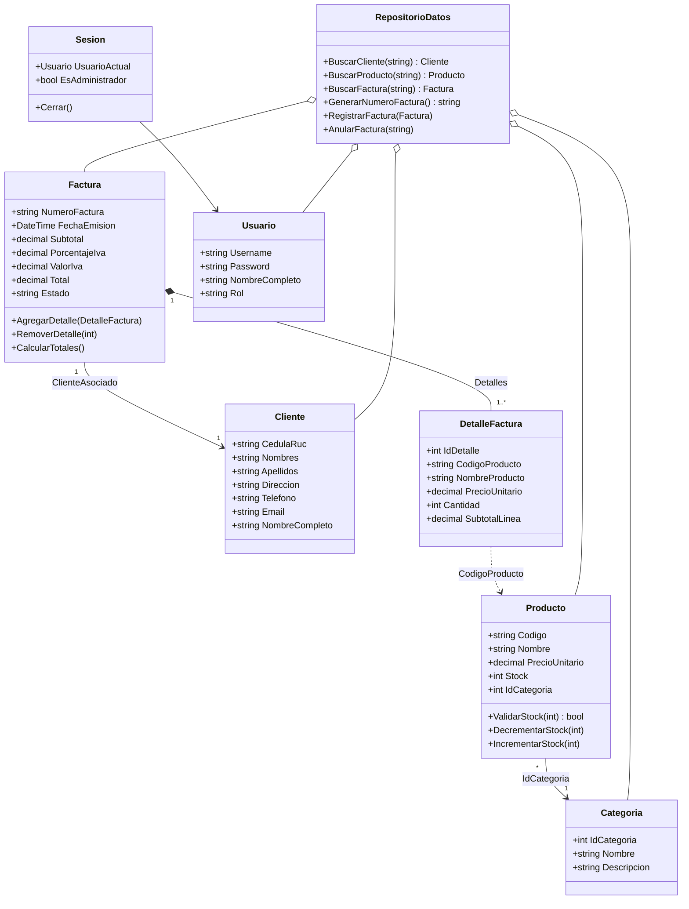

# Sistema de Facturación y Ventas


Aplicación de escritorio para la gestión de **clientes, productos y facturación**, desarrollada en **C#** con **Windows Forms** sobre **.NET Framework 4.8**.

Proyecto integrador de la asignatura **Programación Avanzada** · Cuarto Semestre, paralelo **"C"** · **Universidad Técnica de Machala**, Ecuador.

---

## Tabla de contenidos

1. [Descripción general](#1-descripción-general)
2. [Objetivos](#2-objetivos)
3. [Características](#3-características)
4. [Capturas de pantalla](#4-capturas-de-pantalla)
5. [Tecnologías](#5-tecnologías)
6. [Requisitos](#6-requisitos)
7. [Instalación y ejecución](#7-instalación-y-ejecución)
8. [Guía de uso](#8-guía-de-uso)
9. [Roles y permisos](#9-roles-y-permisos)
10. [Reglas de negocio](#10-reglas-de-negocio)
11. [Validaciones](#11-validaciones)
12. [Arquitectura y estructura del proyecto](#12-arquitectura-y-estructura-del-proyecto)
13. [Modelo de clases](#13-modelo-de-clases)
14. [Datos de ejemplo precargados](#14-datos-de-ejemplo-precargados)
15. [Flujo de trabajo con Git](#15-flujo-de-trabajo-con-git)
16. [Casos de prueba](#16-casos-de-prueba)
17. [Limitaciones conocidas](#17-limitaciones-conocidas)
18. [Trabajo futuro](#18-trabajo-futuro)
19. [Equipo de desarrollo](#19-equipo-de-desarrollo)
20. [Licencia](#20-licencia)

---

## 1. Descripción general

El **Sistema de Facturación y Ventas** automatiza las operaciones básicas de un comercio pequeño: registrar clientes, controlar el inventario, emitir facturas con IVA y consultar el historial de ventas. Cada usuario accede con un rol que limita las operaciones sensibles, como modificar el inventario o anular facturas.

La aplicación está construida con programación orientada a objetos: las reglas de negocio viven dentro de las propias entidades (por ejemplo, `Producto` valida y descuenta su stock, y `Factura` calcula sus totales), y los formularios se limitan a coordinar la interacción con el usuario.

## 2. Objetivos

**Objetivo general:** desarrollar una aplicación de escritorio para la gestión de clientes, productos y facturación, aplicando programación orientada a objetos en C#.

**Objetivos específicos:**

- Modelar las entidades del negocio mediante clases con comportamiento propio.
- Implementar autenticación con control de acceso por rol.
- Implementar el CRUD de clientes y productos con validaciones de entrada.
- Emitir y anular facturas garantizando la consistencia del inventario.
- Ofrecer un historial filtrable con exportación a CSV.

## 3. Características

### Autenticación y sesión
- Inicio de sesión con usuario y contraseña.
- Dos roles: **Administrador** y **Cajero**.
- La sesión activa se mantiene en la clase estática `Sesion`.
- El menú principal verifica que exista una sesión antes de abrirse.

### Panel principal (MDI)
- Contenedor MDI que aloja los formularios hijos.
- Evita abrir dos instancias del mismo formulario.
- Muestra usuario, rol y reloj en vivo (se actualiza cada segundo).
- Tres indicadores: cantidad de productos, cantidad de clientes y **ventas del día** (suma de facturas activas de hoy).
- Los indicadores se recalculan al cerrar cada ventana hija.

### Gestión de clientes
- Crear, consultar, modificar y eliminar clientes.
- Búsqueda por cédula, nombre o apellido.
- Al hacer clic en una fila de la tabla, el formulario se llena automáticamente.
- Confirmación antes de modificar o eliminar.

### Gestión de productos (solo Administrador)
- Crear, actualizar y eliminar productos.
- Filtro en tiempo real por código o nombre (sin distinguir mayúsculas).
- Asociación de cada producto a una categoría.

### Facturación
- Numeración correlativa con formato `FAC-0001`.
- Búsqueda del cliente por cédula/RUC.
- Selección de producto con precio y stock visibles.
- La cantidad máxima se limita al stock realmente disponible, descontando lo ya agregado a la factura.
- Si el producto ya está en la factura, se suma la cantidad en el mismo renglón.
- Cálculo automático de subtotal, IVA (15 %) y total.
- Eliminación de renglones y descarte de la factura con confirmación.

### Historial de facturas
- Vista maestro-detalle: facturas arriba, renglones de la factura seleccionada abajo.
- Filtros combinados por **rango de fechas** (por defecto el último mes), **texto** (número de factura o cédula) y **estado** (Todas, Activas, Anuladas).
- Las facturas anuladas se muestran en gris.
- Indicadores de ingresos y cantidad de ventas (solo facturas activas).
- **Anulación** de facturas con devolución automática del stock (solo Administrador).
- **Exportación a CSV** (separador `;`, codificación UTF-8, compatible con Excel).

## 4. Capturas de pantalla

> Reemplaza estas rutas por las capturas reales del sistema.

| Pantalla | Captura |
|---|---|
| Inicio de sesión | `` |
| Panel principal | `` |
| Clientes | `` |
| Productos | `` |
| Facturación | `` |
| Historial | `` |

## 5. Tecnologías

| Componente | Detalle |
|---|---|
| Lenguaje | C# |
| Plataforma | .NET Framework 4.8 |
| Tipo de proyecto | Aplicación de escritorio (`WinExe`) |
| Interfaz | Windows Forms (MDI) |
| Consultas sobre colecciones | LINQ |
| Almacenamiento | Listas en memoria (`List<T>`) |
| IDE | Visual Studio 2019 o superior |
| Control de versiones | Git / GitHub |

## 6. Requisitos

- Windows 10 o superior.
- .NET Framework 4.8 (incluido en Windows 10 y 11 actualizados).
- Visual Studio 2019 o superior con la carga de trabajo **"Desarrollo de escritorio con .NET"**, para compilar desde el código fuente.

## 7. Instalación y ejecución

1. **Clona el repositorio:**
   ```bash
   git clone https://github.com/[usuario]/ProyectoC-CuartoSemestre.git
   cd ProyectoC-CuartoSemestre
   ```
2. **Abre la solución** `Sistema-De-Facturacion-Ventas.slnx` en Visual Studio. Si tu versión no reconoce el formato `.slnx`, abre directamente el archivo `Sistema-De-Facturacion-Ventas/Sistema-De-Facturacion-Ventas.csproj`.
3. **Restaura y compila** con **Compilar > Compilar solución** (`Ctrl + Shift + B`).
4. **Ejecuta** con **F5** (con depuración) o **Ctrl + F5** (sin depuración).

El ejecutable queda en `Sistema-De-Facturacion-Ventas/bin/Debug/` (o `bin/Release/` si compilas en modo Release).

## 8. Guía de uso

### 8.1 Iniciar sesión

Ingresa con alguno de los usuarios de prueba:

| Usuario | Contraseña | Rol |
|---|---|---|
| `admin` | `admin123` | Administrador |
| `cajero` | `cajero123` | Cajero |

> Son credenciales de prueba. No las uses en un entorno real.

### 8.2 Registrar un cliente

1. Menú principal → **Clientes**.
2. Completa cédula, nombres, apellidos, teléfono y, opcionalmente, dirección y correo.
3. Pulsa el botón de registro. Si algún dato no cumple las validaciones, el sistema muestra el motivo.

### 8.3 Administrar productos (rol Administrador)

1. Menú principal → **Productos**.
2. Ingresa código, nombre, precio, stock y selecciona la categoría.
3. Para modificar o eliminar, escribe el código del producto existente y usa el botón correspondiente.

### 8.4 Emitir una factura

1. Menú principal → **Facturación**.
2. Escribe la cédula del cliente y pulsa **Buscar**.
3. Elige un producto de la lista, define la cantidad y pulsa **Agregar**.
4. Repite el paso anterior con los productos necesarios. Para quitar un renglón, selecciónalo y usa **Eliminar**.
5. Revisa subtotal, IVA y total, y pulsa **Emitir**.
6. El stock se descuenta y se inicia automáticamente una nueva factura.

### 8.5 Consultar, anular y exportar facturas

1. Menú principal → **Historial**.
2. Ajusta fechas, texto y estado, y pulsa **Filtrar** (o **Restablecer** para volver a los valores por defecto).
3. Selecciona una factura para ver su detalle.
4. Como Administrador, pulsa **Anular** para anular una factura activa y reintegrar el stock.
5. Pulsa **Exportar** para guardar el listado visible en un archivo `.csv`.

## 9. Roles y permisos

| Funcionalidad | Administrador | Cajero |
|---|:---:|:---:|
| Iniciar sesión | Sí | Sí |
| Ver panel principal | Sí | Sí |
| Gestionar clientes | Sí | Sí |
| Gestionar productos | Sí | No (menú deshabilitado) |
| Emitir facturas | Sí | Sí |
| Consultar historial | Sí | Sí |
| Anular facturas | Sí | No (botón deshabilitado) |
| Exportar a CSV | Sí | Sí |

## 10. Reglas de negocio

### Cálculo de totales

```
Subtotal = Σ (Cantidad × PrecioUnitario)
IVA      = Redondeo(Subtotal × PorcentajeIva / 100, 2)
Total    = Subtotal + IVA
```

El porcentaje de IVA por defecto es **15 %** (constante `RepositorioDatos.IvaPorDefecto`).

### Emisión en dos fases

`RepositorioDatos.RegistrarFactura` procede así:

1. **Valida** que la factura tenga renglones y que **todos** los productos tengan stock suficiente.
2. Solo si todo es válido, **descuenta** el stock de cada producto.
3. Calcula totales, marca la factura como `Activa` y la guarda.

Si cualquier renglón falla, no se descuenta nada, por lo que el inventario nunca queda con descuentos parciales.

### Anulación

`RepositorioDatos.AnularFactura` reintegra al inventario las cantidades de cada renglón y cambia el estado a `Anulada`. Lanza una excepción si la factura no existe o ya estaba anulada.

### Numeración

El número se genera como `FAC-` seguido de la cantidad de facturas existentes más uno, con cuatro dígitos (`FAC-0001`, `FAC-0002`, …).

## 11. Validaciones

### Clientes

| Campo | Regla |
|---|---|
| Cédula, nombres, apellidos | Obligatorios |
| Nombres y apellidos | Solo letras y espacios |
| Cédula | Solo dígitos, exactamente 10, y válida según el **algoritmo Módulo 10** ecuatoriano |
| Código de provincia | Dos primeros dígitos entre 01 y 24 |
| Tercer dígito | Menor o igual a 5 (persona natural) |
| Teléfono | 10 dígitos que inicien con `09` |
| Correo | Opcional; si se ingresa, formato básico válido |
| Duplicados | No se permiten cédulas ni teléfonos repetidos (al modificar se conserva el propio teléfono) |

### Productos

| Campo | Regla |
|---|---|
| Código, nombre, precio, stock | Obligatorios |
| Código | No puede repetirse (sin distinguir mayúsculas) |
| Precio | Debe ser un número decimal válido |
| Stock | Debe ser un número entero válido |
| Categoría | Debe seleccionarse |

### Facturación

- Debe haber al menos un renglón y un cliente asociado.
- La cantidad debe ser mayor a cero y no puede superar el stock disponible.

## 12. Arquitectura y estructura del proyecto

```
ProyectoC-CuartoSemestre/
├── Sistema-De-Facturacion-Ventas.slnx
└── Sistema-De-Facturacion-Ventas/
    ├── App.config
    ├── Program.cs                 # Punto de entrada: login y luego menú principal
    ├── Datos/
    │   ├── RepositorioDatos.cs    # Almacén en memoria y operaciones de negocio
    │   └── Sesion.cs              # Usuario autenticado y chequeo de rol
    ├── Modelos/
    │   ├── Categoria.cs
    │   ├── Cliente.cs
    │   ├── DetalleFactura.cs
    │   ├── Factura.cs
    │   ├── Producto.cs
    │   └── Usuario.cs
    ├── Formularios/
    │   ├── FormLogin.cs
    │   ├── FormMenuPrincipal.cs
    │   ├── FormClientes.cs
    │   ├── FormProductos.cs
    │   ├── FormFacturacion.cs
    │   └── FormHistorialFacturas.cs
    ├── Images/Fondos/             # Fondos de login y panel principal
    └── Properties/
```

La solución separa tres responsabilidades:

- **Modelos:** entidades del dominio con su comportamiento.
- **Datos:** repositorio en memoria y operaciones críticas del negocio.
- **Formularios:** interfaz de usuario, que delega las reglas en las capas anteriores.

### Principios de POO aplicados

- **Encapsulamiento:** las reglas viven en las entidades (`Producto.DecrementarStock`, `Factura.CalcularTotales`).
- **Reutilización con genéricos:** `AbrirFormulario<T>() where T : Form, new()` abre cualquier formulario hijo sin duplicar código.
- **Polimorfismo:** `ToString()` sobrescrito en `Producto` y `Categoria` para mostrarlos en `ComboBox`.
- **Propiedades calculadas:** `Cliente.NombreCompleto` y `DetalleFactura.SubtotalLinea`.
- **LINQ:** `FirstOrDefault`, `Where`, `Any`, `Sum` y `OrderByDescending` para búsquedas y filtros.
- **Manejo de excepciones:** `InvalidOperationException`, `ArgumentException` y `ArgumentNullException` en dominio y datos, capturadas en los formularios.

## 13. Modelo de clases



## 14. Datos de ejemplo precargados

Al iniciar, `RepositorioDatos` carga datos para poder probar el sistema sin registrar nada.

**Categorías:** Electrónica, Víveres y Papelería.

**Productos:**

| Código | Nombre | Precio | Stock inicial |
|---|---|---:|---:|
| P001 | Mouse inalámbrico | $12.50 | 20 |
| P002 | Arroz 1kg | $1.20 | 3 *(stock crítico a propósito)* |
| P003 | Teclado mecánico | $45.00 | 8 |
| P004 | Aceite 1L | $3.50 | 30 |
| P005 | Cuaderno universitario | $2.25 | 50 |
| P006 | Audífonos | $18.00 | 12 |

**Clientes:** Ana Pérez, Luis Mora y Marta Ruiz.

> Estos clientes se cargan directamente en el repositorio, sin pasar por las validaciones del formulario. Los clientes que se registren desde la pantalla de Clientes sí deben cumplir todas las reglas, incluida la validación de cédula por Módulo 10.

**Factura de ejemplo:** `FAC-0001` para Ana Pérez, con 2 mouse inalámbricos y 1 teclado mecánico: subtotal $70.00, IVA $10.50 y total **$80.50**. Al arrancar, el stock de P001 y P003 ya refleja esa venta (18 y 7 unidades).

## 15. Flujo de trabajo con Git

El equipo trabajó con ramas por funcionalidad:

| Rama | Propósito |
|---|---|
| `master` | Versión estable |
| `develop` | Integración de los avances del equipo |
| `feature/clientes` | Módulo de clientes |
| `feature/Productos` | Módulo de productos |
| `feature/Factura` | Módulo de facturación |
| `feature/historial` | Historial de facturas |
| `login-menu` | Inicio de sesión y menú principal |
| `Rama/DiseñoVisual` | Diseño visual de la interfaz |

Flujo recomendado para nuevas funciones:

```bash
git checkout develop
git pull
git checkout -b feature/nombre-de-la-funcion
# ... trabajar y confirmar cambios ...
git push -u origin feature/nombre-de-la-funcion
# abrir Pull Request hacia develop
```

## 16. Casos de prueba

| N.º | Caso | Resultado esperado |
|---|---|---|
| 1 | Iniciar sesión con `admin` / `admin123` | Acceso concedido; todos los módulos habilitados |
| 2 | Iniciar sesión con `cajero` / `cajero123` | Acceso concedido; menú Productos deshabilitado |
| 3 | Iniciar sesión con credenciales incorrectas | Mensaje de error y contraseña limpiada |
| 4 | Registrar cliente con cédula de dígito verificador incorrecto | Rechazo por incumplir Módulo 10 |
| 5 | Registrar cliente con teléfono ya existente | Rechazo indicando el cliente que lo posee |
| 6 | Facturar más unidades de "Arroz 1kg" que el stock (3) | La cantidad queda limitada al stock disponible |
| 7 | Emitir factura con 2 mouse y 1 teclado | Subtotal $70.00, IVA $10.50, total $80.50 |
| 8 | Emitir factura sin cliente seleccionado | Mensaje que exige buscar un cliente |
| 9 | Anular factura activa como Administrador | Estado `Anulada` y stock reintegrado |
| 10 | Anular una factura ya anulada | Mensaje de que ya está anulada |
| 11 | Exportar historial filtrado | Archivo CSV con las facturas visibles |

## 17. Limitaciones conocidas

- **Sin persistencia:** los datos viven en memoria y se pierden al cerrar la aplicación.
- **Contraseñas en texto plano:** se almacenan y comparan sin cifrado.
- **Integridad referencial:** es posible eliminar clientes o productos que ya aparecen en facturas emitidas.
- **Validaciones de productos incompletas:** no se rechazan precios ni stocks negativos.
- **Selector de categoría:** muestra identificadores en lugar de nombres.
- **Numeración de facturas:** se basa en la cantidad de facturas existentes, no en una secuencia independiente.
- **Estados como texto:** `"Activa"` y `"Anulada"` se comparan como cadenas en lugar de un `enum`.
- **Código sin uso:** existen manejadores de eventos vacíos generados por el diseñador.

## 18. Trabajo futuro

- [ ] Persistencia en base de datos (SQL Server o SQLite).
- [ ] Cifrado de contraseñas con hash y sal (por ejemplo, PBKDF2).
- [ ] Impedir eliminar clientes o productos con facturas asociadas, o usar eliminación lógica.
- [ ] Validar precios y stocks negativos, y mostrar nombres de categoría.
- [ ] Reemplazar los estados de texto por un `enum`.
- [ ] Exportar e imprimir facturas en PDF.
- [ ] Reportes de ventas por período y categoría.
- [ ] Alertas de stock mínimo.
- [ ] Pruebas unitarias sobre `Factura`, `Producto` y `RepositorioDatos`.
- [ ] Adaptación a los requisitos de facturación electrónica del SRI.

## 19. Equipo de desarrollo

| Integrante | GitHub |
|---|---|
| AnthonyLozadaAlexander | [@AnthonyLozadaAlexander](https://github.com/AnthonyLozadaAlexander) |
| kvasquez20 | [@kvasquez20](https://github.com/kvasquez20) |
| JohanT0mate | [@JohanT0mate](https://github.com/JohanT0mate) |
| Branmers14 | [@Branmers14](https://github.com/Branmers14) |
| josephvergara1012-wq | [@josephvergara1012-wq](https://github.com/josephvergara1012-wq) |

**Docente:** [Nombre del docente]
**Asignatura:** Programación Avanzada · Cuarto Semestre "C"
**Institución:** Universidad Técnica de Machala

## 20. Licencia

Proyecto con fines académicos. [Define la licencia si el equipo desea compartirlo públicamente, por ejemplo MIT.]
